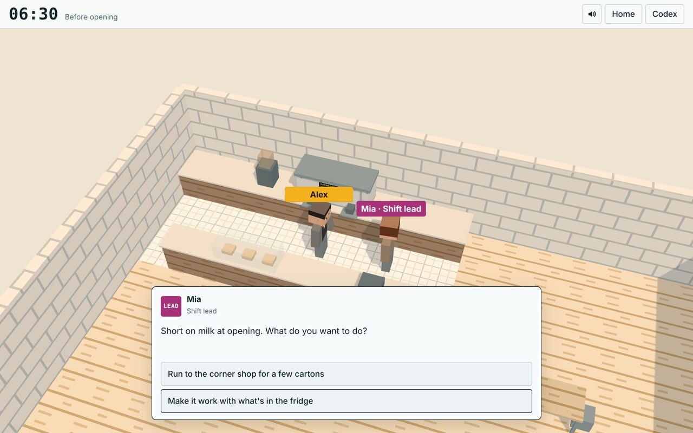
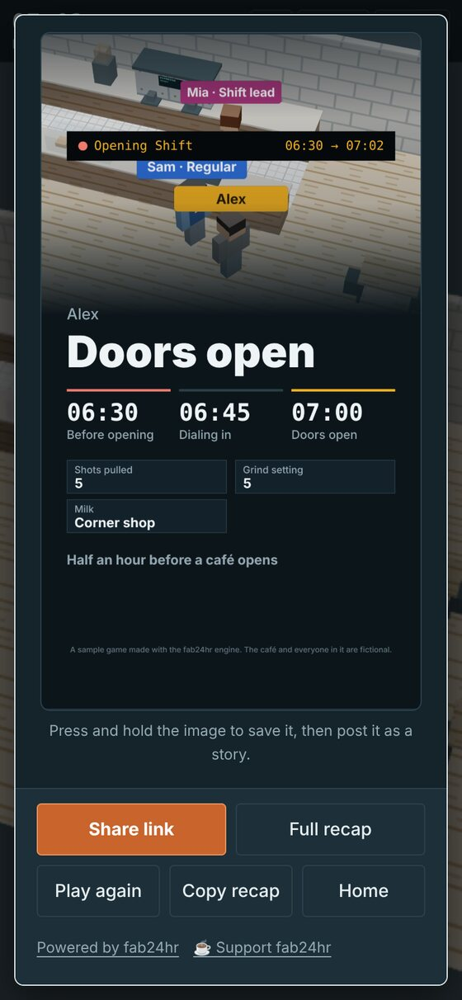

# fab24hr engine

A small framework for browser 3D story games — the kind where you spend one shift as someone in a job most people never see. It is the engine behind [fab24hr](https://fab24hr.com), split out so you can make your own.

Your players get: a blocky 3D place they can walk around (phone or desktop, no install), people who talk to them, a one-line "next step" with a *Take me there* button, phone calls that interrupt, jargon they can tap for a plain explanation, small mini-games, a codex, save and resume, and an ending card: a 9:16 image they can save and post, plus a link to share.

You get: plain JavaScript files with no imports to manage, a build that checks your mistakes, and an automatic playthrough test.

It is free for noncommercial use. If it saves you time, you can [buy the author a coffee](https://buymeacoffee.com/mclty).

<p align="center"> </p>

> **Status: early (0.2).** The sample game below works end to end. Names may still change. What is in each version, and what is not in the engine yet: [`CHANGELOG.md`](CHANGELOG.md).

## Quick start

You need [Node.js](https://nodejs.org) 18 or newer.

```sh
npm install
npm run build      # → public/index.html (open it in a browser, or put the public/ folder on any static host)
npm run dev        # build, serve on http://localhost:8080, rebuild when you save
npm test           # play the whole game twice in a headless browser (desktop + phone)
```

`npm test` needs a Chromium-based browser. If it says none was found, run `npx playwright-core install chromium` once and try again.

Prefer Chinese? `npm run zh` switches the interface and the sample game to Traditional Chinese, and `npm run en` switches back. AI coding tools do this on their own when you write to them in Chinese.

The repository ships with a sample game, **Opening Shift**: half an hour before a small café opens. It is about five minutes long and uses every part of the engine. Its files are in `game/`.

## Make your own game with an AI coding tool

This repository is set up for AI coding tools. Open the folder in one and ask, for example:

> Turn this into a game about a night shift at a train station. Keep it about five minutes long.

The tool reads [`AGENTS.md`](AGENTS.md), which explains how the game files fit together, the rules the build enforces, and how to test. Then run `npm test` and play it yourself.

## Make your own game by hand

Everything about your game lives in `game/`:

| File | What it holds |
| --- | --- |
| `game.json` | Title, language, storage key, and the list of your files in load order |
| `data.js` | Home screen text, the people (`STORY.cast`, `WORLD.cast`), places, glossary |
| `cafe.js` | The 3D place: floor, walls, furniture, where people can stand and walk |
| `story.js` | The moments of the day (`STORY.segs`), one beat at a time (`STORY.beats`), mini-games, the ending |
| `game.css` | Optional colour overrides (light and dark) |

`AGENTS.md` describes each piece in detail.

## What is in the engine

| File | What it does |
| --- | --- |
| `engine/world.js` | The 3D world (three.js r128): blocky people with name tags, walking and pathfinding, camera, "!" and "?" markers, automatic quality |
| `engine/story.js` | Moments and beats, the next-step line, time cards, save and resume, walking to people and talking |
| `engine/dialog.js` | The dialogue box: typing effect, choices, tappable jargon |
| `engine/move.js` | On-screen arrows, the talk button, the edge-of-screen pointer, keyboard |
| `engine/ui.js` | Panels, document windows, notifications, phone calls |
| `engine/share.js` | The 9:16 share card, the card / full-recap views, copy and share-link buttons |
| `engine/home.js`, `end.js`, `codex.js` | Home screen, ending card, codex |
| `engine/sfx.js` | Sound, synthesised with Web Audio (no audio files) |
| `engine/quality.js` | Picks the best resolution and shadows the device can keep smooth |
| `tools/build.js`, `esm.js`, `i18n.js` | The build: joins the files, works out imports and exports, checks load order, bundles with esbuild |

## Support

The engine is free for noncommercial use. If it saves you time, you can [buy the author a coffee](https://buymeacoffee.com/mclty) — it pays for the AI usage that keeps fab24hr and this engine going.

Every game made with the engine shows one small line on its home screen and its ending screen with two links: "Powered by fab24hr" and "☕ Support fab24hr" (the second one in the game's language). The license requires it to stay; you may restyle it to fit your game.

## License

- Engine and tools: the [fab24hr engine License](LICENSE). In short:
  - **Noncommercial use only.** Do not sell a game made with the engine or charge for access to it, sell anything inside it, show ads or sponsored content in it, make it as paid work for a client or an employer, or use it to promote a business. Asking players for voluntary donations (for example, your own tip link with `HOME.support`) is fine, as long as giving or not giving changes nothing in the game.
  - **Keep the credit line** on the home screen and the ending screen. It may be restyled, but not removed, hidden or pointed elsewhere.
  - For commercial use or other terms, write to mcl@mclty.com.
- The sample game's text and art (`game/`): [CC BY 4.0](https://creativecommons.org/licenses/by/4.0/).
- three.js (`vendor/three.min.js`): MIT, see [`THIRD_PARTY.md`](THIRD_PARTY.md).
- The build also puts one line at the top of your game's script: `/*! Made with the fab24hr engine (…) | fab24hr engine License (…) | Copyright … */`. Leave it in as well.
- The name fab24hr, and the story, characters and content of the fab24hr game itself, are not covered by these licenses. Please don't name your game fab24hr or present it as made by its author.

There is no support guarantee. Issues and pull requests are welcome, but answers may be slow. Contact: mcl@mclty.com.

Written by a person working together with AI.

[中文說明](README.zh-Hant.md)
