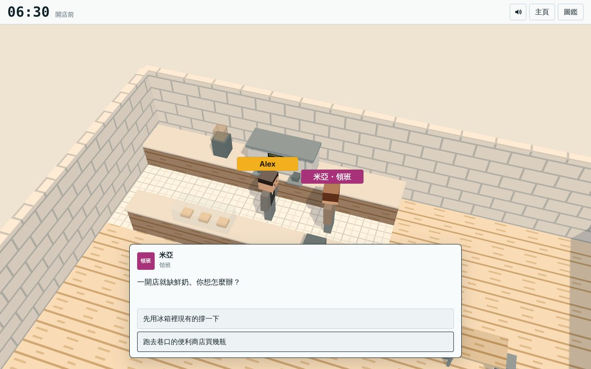
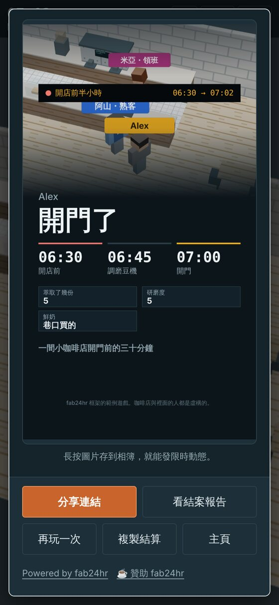

# fab24hr 框架

做網頁 3D 劇情遊戲的小框架，適合「某某職業的一天」這種題材。它是 [fab24hr](https://fab24hr.com) 背後的引擎，拆出來讓你做自己的遊戲。

玩家會得到：可以走動的方塊風 3D 場景（手機、電腦都能玩，不用安裝）、會跟你講話的人、一行「下一步」加「帶我去」、突然打來的電話、點一下就有白話解釋的行話、小遊戲、圖鑑、存檔接著玩，以及結算時一張可以存下來發限時動態的 9:16 圖卡、一個分享連結。

你會得到：一般的 JavaScript 檔（不用自己寫 import）、會替你抓錯的建置，以及自動試玩測試。

非商業用途可以免費使用。如果它幫你省了時間，可以[請作者喝杯咖啡](https://buymeacoffee.com/mclty)。

<p align="center"> </p>

> **現況：早期（0.2）。** 下面的範例遊戲可以從頭玩到尾；名字之後可能還會改。每一版有什麼、框架還沒有什麼：[`CHANGELOG.md`](CHANGELOG.md)（英文）。

## 開始

需要 [Node.js](https://nodejs.org) 18 以上。

```sh
npm install
npm run build      # → public/index.html（直接用瀏覽器開，或把 public/ 放上任何靜態網站）
npm run dev        # 建置、在 http://localhost:8080 開起來，存檔就重建
npm test           # 建置後用無頭瀏覽器把整個遊戲玩兩次（電腦＋手機）
npm run zh         # 換成繁體中文（npm run en 換回英文）
```

`npm test` 要用一個 Chromium 系的瀏覽器。如果它說找不到瀏覽器，先跑一次 `npx playwright-core install chromium` 再試。

**想用中文開發：**`npm run zh` 一次把畫面語言和範例遊戲換成繁體中文（範例變成「開店前半小時」），`npm run en` 換回英文。用中文跟 AI 寫程式工具說話，它會自己先切換成繁體中文，回覆、遊戲內容、註解都用繁體中文。

裡面附一個範例遊戲 **Opening Shift**（中文版叫「開店前半小時」）：咖啡店開門前的半小時，大約 5 分鐘，用到框架的每一個部分。它的檔在 `game/`，英文與繁體中文的原版在 `samples/`。

## 用 AI 寫程式工具做你自己的遊戲

這個 repo 已經為 AI 寫程式工具準備好了。用工具打開資料夾，跟它說，例如：

> 把它改成火車站夜班的遊戲，長度大約 5 分鐘。

工具會先讀 [`AGENTS.md`](AGENTS.md)（遊戲的檔怎麼組在一起、建置會擋哪些錯、怎麼測試）。改完跑 `npm test`，再自己玩一次。

## 支持

框架在非商業用途是免費的。如果它幫你省了時間，可以[請作者喝杯咖啡](https://buymeacoffee.com/mclty)，費用拿去付維持 fab24hr 與這個框架的 AI 使用費。

用框架做的每個遊戲，主頁與結算畫面都有一行小字，兩個連結：「Powered by fab24hr」與「☕ 贊助 fab24hr」（後者跟著遊戲的語言顯示）。授權要求保留它；樣式可以配合你的遊戲調整。

## 授權

- 框架與工具：[fab24hr engine License](LICENSE)。重點：
  - **只能非商業使用。** 用框架做的遊戲不能賣、不能收費才給玩、不能在遊戲裡賣東西、不能放廣告或業配、不能當成接案或公司的有薪工作來做，也不能拿來宣傳生意。可以請玩家自願贊助（例如用 `HOME.support` 放你自己的贊助連結），前提是給不給錢，遊戲都一樣。
  - **保留出處那一行**：主頁與結算畫面都要有。可以換樣式，不可以拿掉、藏起來或改掉連結。
  - 想商用或用其他條件使用，請寫信到 mcl@mclty.com。
- 範例遊戲的文字與圖（`game/`）：[CC BY 4.0](https://creativecommons.org/licenses/by/4.0/deed.zh-hant)。
- three.js（`vendor/three.min.js`）：MIT，見 [`THIRD_PARTY.md`](THIRD_PARTY.md)。
- 建置也會在遊戲程式的最前面放一行：`/*! Made with the fab24hr engine (…) | fab24hr engine License (…) | Copyright … */`，也請留著它。
- fab24hr 這個名字，以及 fab24hr 遊戲本身的劇情、角色與內容，不在上面的授權裡。請不要把你的遊戲取名為 fab24hr，或說成是它的作者做的。

不保證提供支援。歡迎回報問題與送修改，但回覆可能很慢。聯絡：mcl@mclty.com。

由人與 AI 協作寫成。
